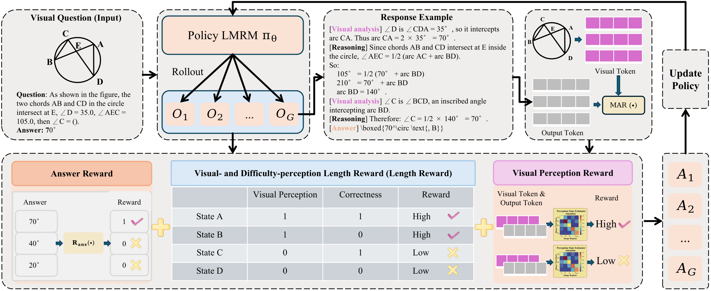

# ThinkWise

### Learning When to Think in Large Multimodal Reasoning Models via Visual and Difficulty Perception

Official implementation of **ThinkWise**, a perception-aware reinforcement learning framework that jointly considers visual engagement and task difficulty to guide reasoning allocation in large multimodal reasoning models.

**ACM Multimedia 2026 (MM '26)** · Rio de Janeiro, Brazil · November 10–14, 2026

[Paper (DOI)](https://doi.org/10.1145/3767308.3835837) · [Code](https://github.com/Zhouwkk/ThinkWise)

**Authors:** Wenkang Zhou\*, Chen Yang\*, Jiaheng Peng, Xitong Li, Hongzhi Yin, Yunke Zhang, Lu Yu†, Peng-Fei Zhang†, Xuhui Ren†, and Shijie Zhang†.

\* Equal contribution. † Corresponding authors.

## Overview

Longer reasoning is not always better for multimodal tasks: when visual grounding is unreliable, additional reasoning can amplify incorrect perceptual premises. ThinkWise addresses this **Reasoning Allocation Misalignment** by conditioning training rewards on visual engagement, answer correctness, and problem difficulty.

The framework uses the **Modality Attention Ratio (MAR)** as an internal proxy for visual engagement. An instance-adaptive threshold, computed from trajectories sampled for the same question, separates relatively strong and weak visual engagement. Three reward components then guide policy optimization:

- **Answer reward:** verifies the final answer against the reference.
- **Visual- and difficulty-perception length reward:** favors concise correct reasoning and encourages further exploration when visual engagement is strong but the answer is incorrect, with stronger incentives on harder questions.
- **Visual perception reward:** distinguishes correct trajectories according to their visual engagement.

MAR is a relative visual-engagement signal, not a direct guarantee of perceptual correctness. ThinkWise shapes reasoning behavior during training; it does not introduce an inference-time stopping controller.

## Framework



For each visual question, the policy samples a group of responses. ThinkWise estimates MAR, derives an adaptive perception state and group-level difficulty, computes the structured rewards, and updates the policy using group-relative advantages.

| State | Visual engagement | Answer | Length-reward behavior |
| --- | --- | --- | --- |
| A | Strong | Correct | Favor concise reasoning and penalize unnecessary verbosity |
| B | Strong | Incorrect | Encourage longer reasoning, weighted by problem difficulty |
| C | Weak | Correct | Penalize overly long reasoning |
| D | Weak | Incorrect | Assign no additional length reward |

The paper defines the combined reward as:

$$
R_{\mathrm{total}} = R_{\mathrm{ans}} + \gamma_{\mathrm{len}}R_{\mathrm{len}} + \gamma_{\mathrm{perc}}R_{\mathrm{perc}}.
$$

The current implementation also includes an auxiliary format reward. Existing filenames, configuration keys, and experiment names retain the earlier **PerceptGate** name; the commands below use those names as they exist in the repository.

## Installation

Training uses Linux, NVIDIA GPUs, CUDA, FlashAttention, and vLLM. A Mac can be used to edit the project and prepare documentation; the provided distributed training pipeline requires a CUDA environment.

```bash
git clone https://github.com/Zhouwkk/ThinkWise.git
cd ThinkWise

conda create -n thinkwise python=3.11 -y
conda activate thinkwise

# Install PyTorch before building FlashAttention.
pip install torch==2.9.1 torchvision==0.24.1 torchaudio==2.9.1
pip install packaging ninja psutil wheel setuptools
pip install flash-attn==2.8.3 --no-build-isolation

pip install -r requirements.txt
pip install -e .
```

Use a CUDA toolkit and PyTorch build compatible with your GPU environment. The pinned package versions are recorded in [requirements.txt](requirements.txt). FlashAttention wheels must match the installed PyTorch, CUDA, Python, and ABI versions.

## Data Preparation

Training data, evaluation data, and model weights are downloaded separately.

### Training: ViRL39K

Download `39Krelease.parquet` and `images.zip` from [TIGER-Lab/ViRL39K](https://huggingface.co/datasets/TIGER-Lab/ViRL39K). Place them in the same data directory, then extract and convert:

```bash
unzip /path/to/ViRL39K/images.zip -d /path/to/ViRL39K

python scripts/prepare_virl39k.py \
  --input /path/to/ViRL39K/39Krelease.parquet \
  --output /path/to/ViRL39K/virl39k_train.json
```

Set `data.image_dir` to the directory containing `images/`, for example `/path/to/ViRL39K`, rather than `/path/to/ViRL39K/images`.

### Validation: MMK12

The following script downloads the MMK12 test split, saves images locally, and writes the JSON file used by training-time validation:

```bash
python scripts/prepare_mmk12_val.py \
  --output_dir /path/to/MMK12
```

The output contains `mmk12_test.json` and an `images/` directory. The script writes absolute image paths so validation images can be loaded independently of the training image directory. The dataset source is [FanqingM/MMK12](https://huggingface.co/datasets/FanqingM/MMK12).

### Input Format

The training loader uses `question`, `answer`, and `image` fields:

```json
{
  "question": "<image>\nWhat is the value of x in the triangle?",
  "answer": "\\boxed{60}",
  "image": ["images/triangle_001.png"]
}
```

Each `<image>` placeholder corresponds to an image in the list. Relative image paths are resolved against `data.image_dir`; absolute paths are also supported. The supplied math prompt asks the model to return its final answer inside `\boxed{}`.

## Training

### Configure Paths

Edit [examples/config_perceptgate.yaml](examples/config_perceptgate.yaml) for your environment:

```yaml
data:
  train_files: /path/to/ViRL39K/virl39k_train.json
  val_files:
    - /path/to/MMK12/mmk12_test.json
  image_dir: /path/to/ViRL39K

worker:
  actor:
    model:
      model_path: /path/to/Qwen2.5-VL-3B-Instruct
```

The full ThinkWise scripts enable curriculum sampling and use the MAR-based reward. Launching the YAML alone does not enable curriculum sampling, so use the full scripts below or explicitly set `algorithm.online_filtering=true`.

### Full ThinkWise: 3B and 7B

Before running, edit the chosen script's `RUN_ROOT`, `CUDA_VISIBLE_DEVICES`, `trainer.n_gpus_per_node`, and any model-path override. Adapt the script's NCCL settings, including `NCCL_SOCKET_IFNAME`, to your server.

```bash
# Qwen2.5-VL-3B-Instruct
FRESH_START=1 bash examples/3b/train_curriculum_full.sh

# Qwen2.5-VL-7B-Instruct
FRESH_START=1 bash examples/7b/train_curriculum_full_7b.sh
```

The supplied 3B full script selects two GPUs; the 7B full script selects four. Adjust GPU IDs and GPU count together for your hardware and memory budget. The 7B script overrides the actor model path, so update that path in the script as well.

`FRESH_START=1` starts from the configured base model. Without it, these full scripts resume when `checkpoint_tracker.json` exists in their checkpoint directory:

```bash
bash examples/3b/train_curriculum_full.sh
```

Logs are written under `${RUN_ROOT}/logs`, and checkpoints under the script's `CHECKPOINT_DIR`.

### Override Configuration Directly

The existing shell scripts do not forward additional command-line arguments. To override settings from the command line, invoke the Python entry point directly. For example, after configuring the paths above:

```bash
CUDA_VISIBLE_DEVICES=0,1 python -m verl.trainer.main \
  config=examples/config_perceptgate.yaml \
  algorithm.online_filtering=true \
  algorithm.hperc_filter_schedule=null \
  trainer.n_gpus_per_node=2 \
  trainer.project_name=thinkwise \
  trainer.experiment_name=thinkwise-3b-short-run \
  trainer.save_checkpoint_path=/path/to/runs/thinkwise-3b-short-run \
  trainer.find_last_checkpoint=false \
  trainer.load_checkpoint_path=null \
  trainer.max_steps=2
```

This limits training updates to two steps; it still performs the configured data loading, model initialization, and pre-training validation.

### Baselines and Ablations

| Setting | 3B script | 7B script |
| --- | --- | --- |
| Full ThinkWise | `examples/3b/train_curriculum_full.sh` | `examples/7b/train_curriculum_full_7b.sh` |
| GRPO baseline | `examples/3b/train_grpo_baseline_3b.sh` | `examples/7b/train_grpo_baseline_7b.sh` |
| Without perception reward | `examples/3b/train_curriculum_ans_len_3b.sh` | `examples/7b/train_curriculum_ans_len_7b.sh` |
| Without length reward | `examples/3b/train_curriculum_ans_perc_3b.sh` | `examples/7b/train_curriculum_ans_perc_7b.sh` |
| Without curriculum | `examples/3b/train_full_no_curriculum_3b.sh` | `examples/7b/train_full_no_curriculum_7b.sh` |
| ThinkWise + PPO | `examples/3b/train_ppo_3b.sh` | `examples/7b/train_ppo_7b.sh` |
| ThinkWise + REINFORCE++ | `examples/3b/train_reinforce_pp_3b.sh` | `examples/7b/train_reinforce_pp_7b.sh` |

Configure paths and hardware settings separately in each script you run. The current reward implementation assumes eight contiguous rollouts per question, matching `worker.rollout.n: 8` in the supplied configuration.

### Export a Training Checkpoint

Merge the FSDP actor checkpoint shards into a Hugging Face-format model:

```bash
python scripts/model_merger.py \
  --local_dir /path/to/checkpoint/global_step_N/actor
```

Replace the path with the actor directory of the checkpoint you want to export. The merged model is saved to the `huggingface/` subdirectory inside that actor directory.

## Repository Structure

```text
ThinkWise/
├── assets/                         # Framework figure
├── examples/
│   ├── config_perceptgate.yaml      # Shared training configuration
│   ├── 3b/                         # 3B training and ablation scripts
│   ├── 7b/                         # 7B training and ablation scripts
│   ├── format_prompt/              # Prompt templates
│   └── reward_function/            # ThinkWise and baseline rewards
├── scripts/                        # Data preparation, model merging, analysis
├── verl/
│   ├── trainer/                    # Training orchestration
│   └── workers/                    # Actor, rollout, reference, and reward workers
└── EXPERIMENT_TRACKER.md            # Historical experiment notes
```

## Citation

```bibtex
@inproceedings{zhou2026thinkwise,
  title     = {ThinkWise: Learning When to Think in Large Multimodal Reasoning Models via Visual and Difficulty Perception},
  author    = {Zhou, Wenkang and Yang, Chen and Peng, Jiaheng and Li, Xitong and Yin, Hongzhi and Zhang, Yunke and Yu, Lu and Zhang, Peng-Fei and Ren, Xuhui and Zhang, Shijie},
  booktitle = {Proceedings of the 34th ACM International Conference on Multimedia},
  year      = {2026},
  doi       = {10.1145/3767308.3835837}
}
```

## Acknowledgments

This repository builds on [veRL](https://github.com/volcengine/verl). We thank the developers of the training infrastructure, datasets, models, and evaluation tools used in this work. Existing source-file copyright and license notices are retained.
